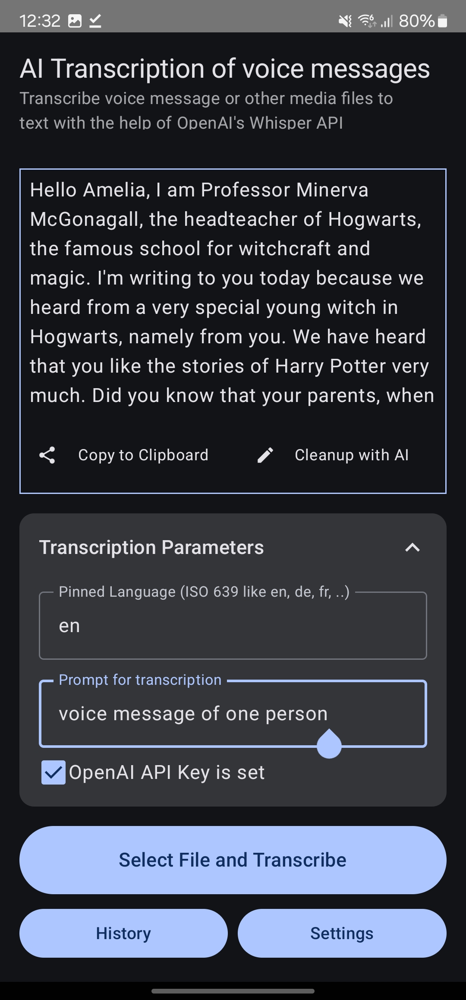
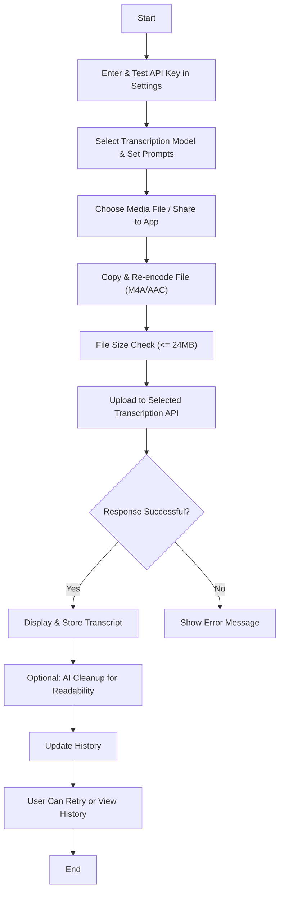

> [!IMPORTANT]
> **This project is paused** in favor of [**hushscribe**](https://github.com/dhcgn/hushscribe).
>
> hushscribe transcribes confidential audio in the browser using attested confidential-computing inference ([Privatemode.ai](https://www.privatemode.ai/)): recordings are encrypted on-device and stay encrypted — even while the model transcribes them inside a TEE. This app, an Android transcription client for OpenAI's Whisper/GPT-4o API, uploads audio to OpenAI's servers for plain server-side processing. On the confidential-computing aspect, it is no match for hushscribe.

# Android AI Transcription App

[GitHub Repository](https://github.com/dhcgn/AIAudioTranscription) • [Copilot Instructions](.github/copilot-instructions.md)



## Overview

This app lets you easily transcribe media files (audio or video) using AI. Users can upload, share, or open media files which are then re-encoded and sent to multiple transcription models. The app supports traditional Whisper-1 transcription, as well as GPT-4o Transcribe and GPT-4o-mini Transcribe models. AI-powered post-processing further improves transcript readability. All transcriptions and settings are stored locally—with your API key secured in encrypted storage.

## Key Features

- **Media Handling:**  
  - Select, share, or open media files directly from your device.
  - Direct transcription of voice messages from messaging apps like WhatsApp, Telegram, or Signal.
  - Automatic re-encoding using **Media3 Transformer** to **M4A/AAC** format (adaptive bitrate 16–32 kbps) for all transcription models.
  - File size check (max. 24MB after processing) to ensure smooth operation.

- **Multiple Transcription Models:**  
  - **Whisper-1:** Traditional audio transcription model.
  - **GPT-4o Transcribe:** Specifically optimized for transcription tasks.
  - **GPT-4o-mini Transcribe:** Efficient transcription model for cost-effective processing.

- **AI-Powered Cleanup:**  
  - Enhance transcript readability with AI-driven cleanup using OpenAI chat completions (GPT-5-nano).
  - Customizable cleanup prompts ensure the original content is preserved while improving clarity.
  - Optional auto-format setting to automatically enhance readability after every transcription.

- **Local History & Settings:**  
  - Maintain a local history of transcriptions with comprehensive statistics:
    - Transcript length (character count)
    - File sizes (original and uploaded)
    - Audio duration (when available)
    - Processing settings used (model, language, prompt)
  - History view displays only relevant information for each entry, with expandable details.
  - Secure API key storage using EncryptedSharedPreferences.
  - In-app Settings allow you to:  
    - Save and test your OpenAI API key.  
    - Configure transcription models and language preferences.  
    - Customize prompts for both transcription and AI cleanup.
    - Enable auto-format to automatically enhance transcriptions after processing.

- **User Experience Enhancements:**  
  - Support for shared intents (from other apps) and direct file access.
  - Retry functionality for reprocessing files with updated parameters.
  - Clear, responsive UI built with Jetpack Compose and modern Android architecture practices.

- **Use Cases:**
  - Convert voice messages to text for easy reading and sharing
  - Archive and search through voice message content
  - Make voice messages accessible for hearing-impaired users
  - Quick transcription of meeting recordings and lectures

## How It Works

1. **Initialization & Setup:**  
   - Enter and test your OpenAI API key in the Settings screen.
   - Choose your transcription model and set any custom prompts or language preferences.

2. **Media Processing:**  
   - Select a media file, or share one to the app.
   - The file is copied, re-encoded to AAC format, and its size is validated.

3. **Transcription & Cleanup:**  
   - The processed file is uploaded to the selected transcription API.
   - Once transcribed, the text is optionally enhanced with an AI cleanup process.
   - The final transcript is displayed and stored locally with comprehensive statistics:
     - File sizes (original and processed)
     - Transcript length
     - All processing parameters used

4. **History & Management:**  
   - View past transcriptions with detailed statistics (file sizes, transcript length, duration).
   - Each entry shows only relevant processing settings that were actually used.
   - Copy transcriptions with or without detailed statistics.
   - Delete individual entries or clear all history as needed.

## Flowchart



## Play Store Information

### App Name

```
AI Universal Transcriber
```

### Short Description
*(80 characters max)*

```
Transcribe audio & video with OpenAI Whisper & GPT-4o using your own API key.
```

### Full Description
*(~2,950 characters)*

```
AI Universal Transcriber turns any audio or video file into accurate text using OpenAI's powerful transcription models. Bring your own OpenAI API key and transcribe voice messages, meetings, interviews, lectures, and more — directly on your Android device.

── HOW IT WORKS ──

Select a file, share one from another app, or open it directly — the app handles the rest. Files are automatically re-encoded to an optimized format before upload, so even large recordings work seamlessly. The transcript appears in seconds, ready to copy or share.

── THREE TRANSCRIPTION MODELS ──

• Whisper-1 — OpenAI's proven model, reliable across a wide range of languages and accents.
• GPT-4o Transcribe — State-of-the-art accuracy powered by GPT-4o's deep audio understanding.
• GPT-4o-mini Transcribe — Fast and cost-efficient, ideal for everyday transcription needs.

Switch between models in Settings at any time. A Retry button lets you re-run the same file with a different model without re-selecting it.

── AI TEXT CLEANUP ──

Raw transcripts can be polished with a single tap. The built-in Reformat feature sends the transcript to GPT-5-nano, which adds punctuation, capitalization, and natural paragraph breaks — without altering a single word. Customize the cleanup prompt to fit your needs, or enable Auto-Format to apply it automatically after every transcription.

── SHARE FROM ANY APP ──

AI Universal Transcriber registers as a share target for audio and video files. Transcribe WhatsApp voice messages, Telegram audio, downloaded recordings, or any file your other apps can share — without disrupting your workflow.

── TRANSCRIPTION HISTORY ──

Every transcription is saved locally on your device. Browse past results, view file sizes and model details, copy with or without full statistics, and delete individual entries or your entire history at any time.

── SMART LARGE-FILE HANDLING ──

The app automatically re-encodes files to M4A/AAC and intelligently reduces the bitrate across multiple attempts to stay within the API's upload limit — so large recordings that other tools would simply reject are handled gracefully.

── PRIVACY & SECURITY ──

• Your API key is stored in encrypted storage (AES256-GCM) — never in plain text.
• Audio is sent only to OpenAI's official API — no third-party servers involved.
• No usage data is collected.
• Your transcription history stays entirely on your device.

── KEY FEATURES ──

✓ Transcribe any audio or video format
✓ Three OpenAI transcription models to choose from
✓ AI-powered text cleanup with a fully customizable prompt
✓ Auto-Format option for hands-free post-processing
✓ Share-to support from any app (WhatsApp, Telegram, and more)
✓ Language selection or automatic detection
✓ Separate configurable prompts for Whisper-1 and GPT-4o
✓ Full transcription history with metadata
✓ Encrypted API key storage
✓ Adaptive bitrate re-encoding for large files
✓ Copy to clipboard or save as a text file for long transcripts
✓ One-tap retry on the last file

── REQUIREMENTS ──

An OpenAI API key with access to audio transcription models is required. Standard OpenAI API usage charges apply.
```

## Privacy & Legal Notice

- **Third-Party Processing:**  
  Your media files are sent to OpenAI’s servers. Ensure you have permission to share and transcribe them.
  
- **Sensitive Data:**  
  Do not transcribe content with sensitive personal or confidential information.

- **User Responsibility:**  
  Use your own OpenAI API key. You are responsible for any costs incurred, and you must comply with OpenAI’s Terms of Service.


## Testing

For developers and testers who want to build the app with a pre-configured OpenAI API key for testing, see the [Testing Guide](TESTING.md). This allows you to create builds with embedded API keys without committing secrets to the repository.


## Next Steps
Future enhancements include:

- Refactoring UI state management into ViewModels.
- Consolidating duplicated code and further adopting Kotlin coroutines with Retrofit’s suspend functions.
- Enhancing the UI and user interaction flow.
